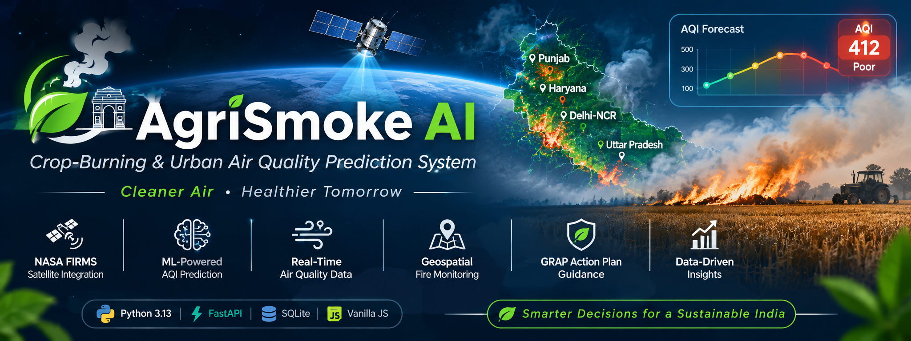
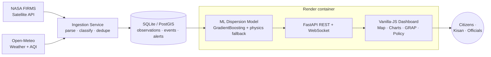

<div align="center">



# AgriSmoke AI

**Transboundary crop-residue smoke transport modeling & urban AQI prediction for the Indo-Gangetic Airshed (Punjab · Haryana · Delhi-NCR).**

Powered by live **NASA FIRMS** satellite detections, **Open-Meteo** meteorology, and a calibrated machine-learning dispersion model.

[](LICENSE)


</div>

---

## Overview

**AgriSmoke AI** is a full-stack environmental intelligence platform that predicts how agricultural stubble-burning ("parali") smoke in Punjab and Haryana is transported into the Delhi-NCR airshed, and translates that into **live AQI forecasts, GRAP graded-response advisories, and policy what-if scenarios**.

Every headline number is derived from **real satellite and weather data** — the dashboard is built as a public good with **no fake or showcase elements**. A browser-only dashboard, a Python ML backend, and an automated satellite-ingestion pipeline work together as one system.

> **Design principles:** live data only · plain language · light professional theme · accessible (EN / हिन्दी) · honest about data freshness.

---

## Key Features

- 🛰️ **Live satellite ingestion** — NASA FIRMS VIIRS/MODIS thermal anomalies, normalized, geoclassified (agricultural vs. forest/industrial), and SHA-256 deduplicated.
- 🌦️ **Real meteorology** — Open-Meteo wind, temperature, humidity, and planetary-boundary-layer height (key-free).
- 🧠 **ML + physics hybrid** — a Gradient-Boosting dispersion model (R² ≈ 0.99) with a deterministic Gaussian-plume fallback so it never goes down.
- 🗺️ **Geospatial plume map** — custom Canvas engine with fire hotspots, dispersion plume, monitoring stations, and a pulsing **Delhi-NCR impact target** + in-map legend & live chip.
- 📊 **GRAP Stages & Alerts** — warnings computed from the current live prediction (not hard-coded).
- ⚖️ **Policy Simulator** — what-if table computed live from bio-decomposer / Happy-Seeder adoption rates.
- 📥 **Export & Print** — CSV diagnostic report and a structured printable briefing.
- 🌐 **i18n** — English / हिन्दी toggle with persisted preference.
- 📱 **Responsive & offline** — installable PWA with a network-first service worker; the sidebar collapses to an icon rail on tablets and opens as an off-canvas drawer on phones.
- 🔒 **Production-hardened** — CSP, locked CORS, HSTS, read-only mode, gated API docs, rate limiting, non-root container, `/api/health`.

---

## Tech Stack

| Layer | Technology |
|---|---|
| **Backend** | Python 3.13, FastAPI, Uvicorn, Pydantic v2 |
| **Machine Learning** | scikit-learn (GradientBoosting), XGBoost, pandas, NumPy, joblib |
| **Data Sources** | NASA FIRMS (Fire API), Open-Meteo (Weather & Air Quality) |
| **Database** | SQLite (launch) · PostgreSQL + PostGIS (planned) |
| **Frontend** | Vanilla JS engines (Canvas map, SVG charts, client model), HTML5/CSS3 |
| **PWA** | Service Worker (network-first), Web App Manifest |
| **Scheduling** | In-process ingestion scheduler · GitHub Actions cron (planned) |
| **Deployment** | Docker, docker-compose, Nginx, Render |
| **Quality** | pytest-style end-to-end suite, GitHub Actions CI, `pip-audit` |

---

## Architecture



The FastAPI app serves the frontend **and** the API from the **same origin**, so no cross-origin calls are required in production.

---

## Repository Structure

```
.
├── assets/                 # Brand assets (SVG banner)
├── frontend/               # Single-page dashboard (vanilla JS, light theme, PWA)
│   ├── index.html          # App shell & tab panels
│   ├── css/styles.css      # Professional light theme (CSS variables)
│   └── js/                 # app controller · Canvas map · SVG charts · client model · i18n
├── backend/                # Python 3.13 FastAPI backend
│   ├── main.py             # API, security middleware, static delivery
│   ├── app_config.py       # Env-driven config (CORS · read-only · rate limits)
│   ├── database.py         # Data access layer (SQLite)
│   ├── scheduler.py        # Background FIRMS/weather ingestion
│   ├── integrations/       # nasa_firms/ · weather/ · air_quality/
│   ├── policy_simulator.py # CRM benefit-cost modeling
│   ├── alerts_dispatcher.py# GRAP rules + multi-channel dispatch
│   └── run.py              # Server launcher
├── database/               # Schema, seeder, SQLite file (+ PostGIS schema)
├── ai-ml/                  # Dataset generator · trainer · inference · model artifacts
├── deploy/                 # Dockerfile · docker-compose · nginx · local run scripts
├── tests/                  # End-to-end test suite (DOM · DB · FIRMS · ML · API)
├── doc/                    # Architecture · API spec · data dictionary · ML · setup
├── .github/workflows/      # CI (tests + docker build + pip-audit)
└── render.yaml             # Render deployment blueprint
```

---

## Quickstart

### Option A — Docker (recommended)
```bash
docker compose -f deploy/docker-compose.yml up --build
# Dashboard: http://localhost:8000
```

### Option B — Manual (Python 3.13)
```bash
# 1. (optional) configure secrets
cp .env.example .env       # set NASA_FIRMS_MAP_KEY for live satellite data

# 2. Install dependencies
python -m pip install -r backend/requirements.txt

# 3. Initialize the database
python database/init_db.py

# 4. Train the ML model (also auto-heals at runtime if skipped)
python ai-ml/train_model.py

# 5. Start the server
python backend/run.py
```

### Option C — One-click
- **Windows:** double-click `deploy/run_local.bat`
- **Linux / macOS:** `./deploy/run_local.sh`

Once running:
- **Dashboard →** http://127.0.0.1:8000
- **Swagger docs →** http://127.0.0.1:8000/docs  *(development only — hidden in production)*

---

## Configuration

All runtime behavior is driven by environment variables (see [`.env.example`](.env.example)). Secrets are never committed (`.env` is git-ignored).

| Variable | Default | Purpose |
|---|---|---|
| `ENVIRONMENT` | `development` | `production` ⇒ read-only + docs off + HSTS |
| `HOST` / `PORT` | `0.0.0.0` / `8000` | Server bind (use `0.0.0.0` in containers) |
| `NASA_FIRMS_MAP_KEY` | _empty_ | Free key from [firms.modaps.eosdis.nasa.gov](https://firms.modaps.eosdis.nasa.gov/api/map_key/) — enables live detections; masked in logs |
| `CORS_ORIGINS` | same-origin | Comma-separated explicit origins (never `*` with credentials) |
| `DOCS_ENABLED` | dev only | Expose `/docs` + `/openapi.json` |
| `READ_ONLY` | prod on | Block all state-changing endpoints |
| `RATE_LIMIT_PER_MINUTE` | `60` | Per-client limit on ML/report endpoints |
| `DB_PATH` | repo SQLite | Point at a mounted volume on PaaS |

> Without a FIRMS key the app runs in a **safe seeded-baseline mode** and clearly labels data as non-live.

---

## API Overview

| Method | Endpoint | Description |
|---|---|---|
| `GET` | `/api/health` | Lightweight liveness probe (PaaS health check) |
| `GET` | `/api/status` | System status + live benchmark AQI |
| `GET` | `/api/stations` | Monitoring stations enriched with live PM2.5/PM10/AQI |
| `GET` | `/api/hotspots` | Live FIRMS fire hotspots (district-aggregated) |
| `GET` | `/api/districts` | District-wise live fire counts |
| `POST` | `/api/predict` | ML AQI prediction + 24 h diurnal forecast |
| `GET` | `/api/v1/predict/live` | Prediction driven by actual last-48 h FIRMS counts |
| `GET` | `/api/v1/weather/live` | Real-time meteorology & boundary-layer height |
| `GET` | `/api/v1/firms/observations` | Query normalized satellite detections |
| `POST` | `/api/v1/firms/sync` | Trigger on-demand ingestion |
| `GET` | `/api/v1/policy/simulate` | Crop-residue-management benefit-cost simulation |
| `GET` | `/api/export/csv` | Downloadable diagnostic report |
| `WS` | `/ws/telemetry` | Real-time telemetry stream |

Full reference: [`doc/API_SPECIFICATION.md`](doc/API_SPECIFICATION.md).

---

## Machine Learning Model

- **Selected algorithm:** Gradient Boosting Regressor (benchmarked against RandomForest, XGBoost, Ridge; highest R² wins).
- **Accuracy:** R² ≈ **0.99** on the held-out test set (see `ai-ml/models/metrics.json`).
- **Features:** fire count, wind speed/direction, PBL height, urban baseline AQI, mitigation adoption, temperature, humidity + engineered transport/ventilation terms.
- **Robustness:** if the serialized model is missing or unreadable (e.g. a scikit-learn version change), the engine **auto-retrains locally**, then falls back to a deterministic physics equation — the API never returns empty.

Details: [`doc/ML_MODEL_DOC.md`](doc/ML_MODEL_DOC.md).

---

## Security & Production Hardening

Built to be safely exposed to the public internet:

- **Content-Security-Policy** tuned for the app (self-hosted scripts only, Google Fonts, same-origin data).
- **CORS** locked to explicit origins; no wildcard-with-credentials.
- **Read-only mode** in production blocks write endpoints (`405`) while keeping stateless `/api/predict`.
- **API docs & OpenAPI hidden** in production.
- **HSTS**, `X-Frame-Options: DENY`, `nosniff`, `Referrer-Policy`, `Permissions-Policy`.
- **Rate limiting** on CPU-heavy endpoints; central exception handler that never leaks stack traces to clients.
- **Secrets from environment only**, masked API key in logs/responses, strong `.gitignore`.
- **Non-root container** with healthcheck; **CI** runs the test suite, a Docker build, and `pip-audit`.

---

## Deployment

- **Render (FastAPI + static frontend)** — deploy via the [`render.yaml`](render.yaml) blueprint or the [`deploy/Dockerfile`](deploy/Dockerfile). TLS is automatic; set `ENVIRONMENT=production` and `NASA_FIRMS_MAP_KEY` (secret) in the dashboard.
- **Supabase (PostgreSQL + PostGIS)** — planned target. The PostGIS schema is staged in `database/`; the data-access layer still needs a Postgres migration before cutover (see docs).
- **GitHub Actions** — CI is live (`.github/workflows/ci.yml`); scheduled FIRMS ingestion is the planned next workflow (works once ingestion targets Supabase).

Guidance: [`doc/SETUP_GUIDE.md`](doc/SETUP_GUIDE.md) and [`doc/ARCHITECTURE.md`](doc/ARCHITECTURE.md).

---

## Testing

```bash
python tests/run_all_tests.py
```
Runs **10** end-to-end suites — frontend DOM references, PWA & static-asset serving, SQLite schema/CRUD, SQLite production readiness (WAL/backup/retention), scheduler ingestion & backup automation, NASA FIRMS ingestion, on-demand FIRMS (stateless deployment), ML & dispersion physics, the FastAPI endpoint layer (**26 endpoints**), and secret-leakage/redaction hardening. Currently **10/10 passing**.

---

## Documentation

| Doc | Contents |
|---|---|
| [`ARCHITECTURE.md`](doc/ARCHITECTURE.md) | System design & ER diagram |
| [`API_SPECIFICATION.md`](doc/API_SPECIFICATION.md) | Complete REST reference |
| [`DATA_DICTIONARY.md`](doc/DATA_DICTIONARY.md) | Table/column definitions |
| [`ML_MODEL_DOC.md`](doc/ML_MODEL_DOC.md) | Benchmarks & physics formulations |
| [`SETUP_GUIDE.md`](doc/SETUP_GUIDE.md) | Install & deployment walkthrough |
| [`PHASE_0_AUDIT.md`](doc/PHASE_0_AUDIT.md) | Audit log |

---

## Roadmap

- [ ] Migrate the data-access layer to **Supabase PostgreSQL + PostGIS** (complete/seed schema).
- [ ] Move scheduled **NASA FIRMS ingestion to GitHub Actions / Render Cron**.
- [ ] **Citizen "air near me"** view with location-based advisories.
- [ ] Full Hindi (i18n) coverage of computed alert & policy text.
- [ ] Expanded backend test coverage for the Postgres path.

---

## Contributing

Contributions are welcome. Open an issue first for significant changes, then submit a pull request — the CI suite must pass. See [`AGENT.md`](AGENT.md) for project conventions.

---

## License & Acknowledgements

Licensed under the **MIT License** — see [LICENSE](LICENSE). Copyright © 2026 AAKASH G.

Data courtesy of **NASA FIRMS / Earthdata**, **Open-Meteo**, and the **CPCB / CAQM GRAP** framework.

> **Disclaimer:** Predictions are decision-support estimates from satellite + model data, not a certified regulatory measurement. Consult official CPCB/CAQM channels for statutory air-quality action.
