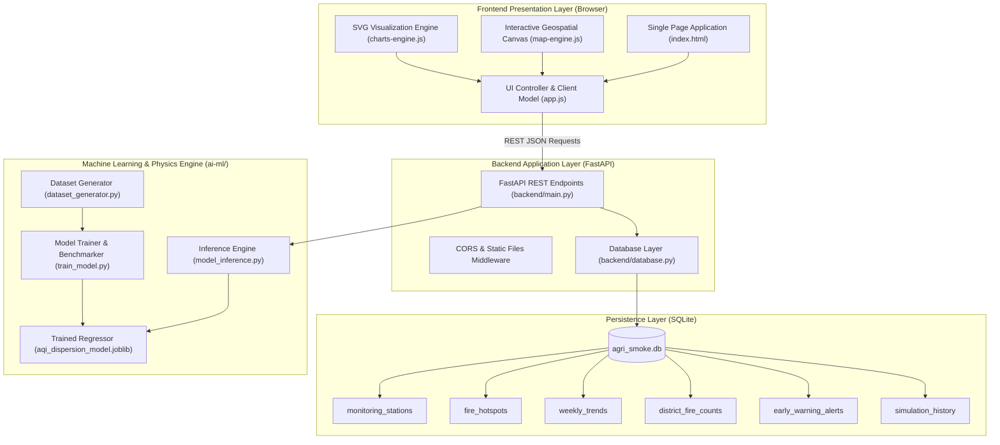
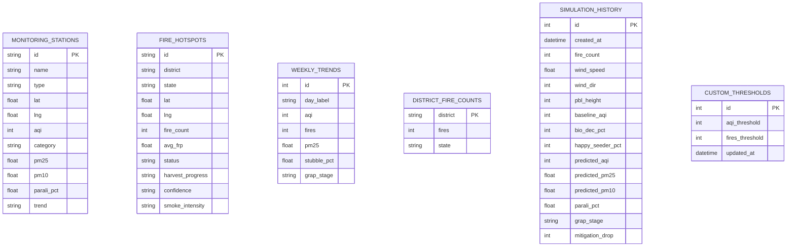

# 🏗️ AgriSmoke AI &bull; System Architecture & Technical Design

The **AgriSmoke AI** platform is an end-to-end atmospheric dispersion, machine learning inference, and air quality simulation system for the **Indo-Gangetic Airshed** (Punjab, Haryana, Delhi-NCR, and Western UP).

---

## 1. System Architecture Overview



---

## 2. Directory Hierarchy

```
evs fine/
├── frontend/                # Interactive Web User Interface
│   ├── index.html           # Semantic Single-Page Dashboard & Tab panels
│   ├── css/
│   │   └── styles.css       # Glassmorphism, CSS variables, dark theme
│   └── js/
│       ├── app.js           # Client orchestrator, live API connector & debouncer
│       ├── charts-engine.js # Pure SVG vector charting engine
│       ├── demo-data.js     # Calibrated baseline reference data
│       ├── map-engine.js    # Canvas geospatial projection & particle flow
│       └── prediction-model.js # Deterministic client fallback model
│
├── backend/                 # Python 3.13 FastAPI Backend
│   ├── main.py              # REST API routes & static file delivery
│   ├── database.py          # SQLite database connection & CRUD queries
│   ├── run.py               # 1-Click backend launcher
│   └── requirements.txt     # Python backend dependencies
│
├── database/                # Relational Data Storage
│   ├── schema.sql           # SQLite database schema
│   ├── init_db.py           # Seeder script for monitoring stations & hotspots
│   └── agri_smoke.db        # Production SQLite database file
│
├── ai-ml/                   # Machine Learning Training & Inference
│   ├── dataset_generator.py # Synthesizes calibrated atmospheric dataset
│   ├── train_model.py       # Trains Gradient Boosting, RF & XGBoost regressors
│   ├── model_inference.py   # Loads serialized model & computes CPCB AQI
│   ├── training_data.csv    # 6,500 observation atmospheric dataset
│   └── models/
│       ├── aqi_dispersion_model.joblib # Serialized optimal ML model
│       ├── scaler.joblib    # Feature standardizer
│       └── metrics.json     # Model validation scores & feature importances
│
├── deploy/                  # Production & Local Deployment
│   ├── Dockerfile           # Multi-stage production container
│   ├── docker-compose.yml   # Docker Compose service definition
│   ├── run_local.bat        # Windows 1-click startup batch script
│   ├── run_local.sh         # Linux/macOS startup shell script
│   └── nginx.conf           # Reverse proxy configuration
│
└── doc/                     # System Documentation
    ├── ARCHITECTURE.md      # System architecture & data flow
    ├── API_SPECIFICATION.md # REST API endpoint schemas & curl examples
    ├── ML_MODEL_DOC.md      # Model benchmarks, physics equations & features
    └── SETUP_GUIDE.md       # Step-by-step setup and deployment guide
```

---

## 3. Database Entity Relationship (ER)



---

## 4. Dual-Mode Operation (Live API + Offline Fallback)

The architecture guarantees high availability and zero-installation usage through a **Dual-Mode System**:
1. **Live Backend Mode (Connected to FastAPI & SQLite)**:
   - When `python backend/run.py` is active, the frontend connects to `http://127.0.0.1:8000`.
   - Real-time ML predictions use the trained `GradientBoostingRegressor` model ($R^2 = 0.9886$).
   - Stations, hotspots, weekly trends, and alerts hydrate dynamically from the SQLite database.
   - Simulation runs are logged to SQLite for historical audits.
2. **Standalone Local Mode (Zero Installation)**:
   - If the backend is offline or the user opens `index.html` directly via `file:///`, the frontend smoothly falls back to the embedded deterministic physics dispersion engine in `prediction-model.js`.
   - The user is notified gracefully via the status badge without console errors or interrupted functionality.

