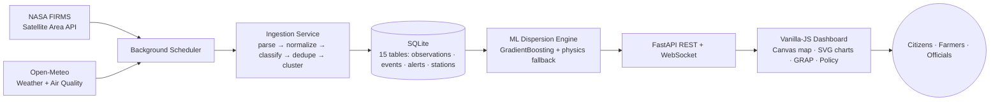

# AgriSmoke AI — Complete Project Documentation

> **Version:** 2.0 · **Scope:** every module, component, calculation, and inter-module interaction in the platform.
> This document is a full technical walkthrough suitable for explaining the entire project structure and workflow end-to-end.

---

## Table of Contents

1. [What the Platform Does](#1-what-the-platform-does)
2. [System Architecture & Data Flow](#2-system-architecture--data-flow)
3. [End-to-End Request Lifecycle](#3-end-to-end-request-lifecycle)
4. [Backend Modules (FastAPI Layer)](#4-backend-modules-fastapi-layer)
5. [Data Integrations (NASA FIRMS, Weather, Air Quality)](#5-data-integrations)
6. [AI/ML Subsystem](#6-aiml-subsystem)
7. [How Every Dashboard Value Is Calculated](#7-how-every-dashboard-value-is-calculated)
8. [Database Layer & Schema](#8-database-layer--schema)
9. [Frontend Modules](#9-frontend-modules)
10. [The Geospatial "Geopolitical" Map Engine](#10-the-geospatial-geopolitical-map-engine)
11. [Alerts, GRAP & Policy Simulation](#11-alerts-grap--policy-simulation)
12. [Security, Configuration & Deployment](#12-security-configuration--deployment)
13. [Testing & Documentation Ecosystem](#13-testing--documentation-ecosystem)

---

## 1. What the Platform Does

**AgriSmoke AI** predicts how smoke from agricultural stubble burning ("parali") in Punjab and Haryana is transported into the Delhi-NCR airshed, and converts that into live AQI forecasts, graded regulatory advisories (GRAP), and policy what-if scenarios.

The core question it answers is:

> *"Given how many farm fires NASA satellites see right now, and given the real wind, humidity and boundary-layer height, how bad will Delhi's air be — how much of it is farm smoke vs. local pollution — and what happens if we intervene?"*

Three answers power everything downstream:

| Signal | Source | Live or Fallback |
|---|---|---|
| **Fire count & locations** | NASA FIRMS VIIRS/MODIS satellite thermal anomalies | Live after ingestion; seeded baseline otherwise |
| **Meteorology** (wind, temp, humidity, PBL height) | Open-Meteo forecast API (key-free) | Live with cached seasonal fallback |
| **Ground air quality** (station PM2.5/PM10/AQI) | Open-Meteo Air Quality API | Live enrichment of stored station records |

Everything is computed by a **hybrid ML + physics model** (a Gradient Boosting regressor trained on a physics-calibrated dataset, with a deterministic Gaussian-plume equation as a never-fail fallback), and surfaced through an **offline-capable vanilla-JS dashboard** with a custom Canvas map and SVG chart engine — zero external CDN dependencies.

**Design principles:** live data only · honest freshness labeling · plain language · light professional theme · bilingual (EN / हिन्दी) · no auth, no decorative filler.

---

## 2. System Architecture & Data Flow



The platform is a **monolith-by-design** public good: one FastAPI process serves the API, runs the ML engine, hosts the background ingestion scheduler, and delivers the static frontend from the **same origin** (`/` → `frontend/index.html`, `/css` and `/js` mounted as static dirs). This means no cross-origin calls in production and one container to deploy.

### Layer responsibilities

| Layer | Location | Responsibility |
|---|---|---|
| **Data ingestion** | `backend/integrations/`, `backend/scheduler.py` | Pull live satellite + weather data, normalize, classify, deduplicate, persist |
| **Persistence** | `backend/database.py`, `database/` | SQLite data-access layer + schema + seeder |
| **Computation** | `ai-ml/` | Dataset generation, model training, inference, forecast curves, drift evaluation |
| **API & security** | `backend/main.py`, `app_config.py`, `security.py` | 26+ REST endpoints, CSP/rate-limit/read-only middleware, secret redaction |
| **Domain logic** | `policy_simulator.py`, `alerts_dispatcher.py` | Benefit-cost CRM modeling, GRAP rule engine, multi-channel dispatch |
| **Presentation** | `frontend/` | Tab dashboard, Canvas geospatial map, SVG charts, client-side mirror model, i18n, PWA |

---

## 3. End-to-End Request Lifecycle

Walking through what happens from satellite to pixel:

1. **Boot** — `backend/run.py` launches Uvicorn → `main.py` loads `.env`, imports the ML `predictor` singleton (which self-heals: loads `aqi_dispersion_model.joblib`, or auto-retrains, or drops to physics fallback), and the FastAPI `startup` event starts the `IngestionScheduler` daemon thread.

2. **Ingestion (every 3 hours)** — the scheduler calls `FirmsIngestionService.ingest_observations()`:
   - `client.py` fetches a CSV of thermal anomalies for the Indo-Gangetic bounding box (`73.5,27.5,78.5,32.5`) from the NASA Area API, with 3 retries and exponential backoff on 429/5xx;
   - `parser.py` validates rows → `normalizer.py` builds canonical records with **SHA-256 IDs** (dataset + lat/lon + date + time) so repeated syncs deduplicate via `INSERT OR IGNORE`;
   - `service.py._find_matching_district()` does Haversine proximity association (≤ 35 km) against the `districts` master table;
   - `classifier.py` labels each detection `agricultural` / `industrial` / `forest_vegetation` / `requires_verification` / `unclassified`;
   - `cluster_events()` groups same-day detections within 3.5 km into `fire_events`, estimates smoke tonnage, and auto-inserts alerts for clusters with total FRP ≥ 100 MW;
   - sync metadata is recorded in `data_sync_jobs` and `data_provider_status`.

3. **Weather (every 15 minutes)** — the scheduler refreshes the `WeatherService` cache (Open-Meteo current conditions + hourly boundary-layer height → PBL), and `/api/stations` enriches monitoring stations concurrently (thread pool, max 4 workers) with live PM2.5/PM10 from the Open-Meteo Air Quality API.

4. **Dashboard load** — `app.js` probes `GET /api/status` with a 2.5 s timeout. On success (`isBackendConnected = true`) it hydrates `DEMO_DATA` arrays from `/api/stations`, `/api/hotspots`, `/api/trends/weekly`, `/api/districts`, `/api/thresholds`, then pulls up to 1000 raw FIRMS observations via `/api/v1/firms/observations` into the map engine. On failure, the UI switches to **Standalone Offline Mode** and every number is computed by the built-in JavaScript physics mirror (`prediction-model.js`).

5. **Prediction** — every slider change runs the local model **instantly** (zero perceived lag), then debounces a 120 ms `POST /api/predict` to the Python GradientBoosting model; when the response arrives it replaces the local numbers (server is authoritative).

6. **Auto-refresh** — a 60 s timer re-pulls `/api/v1/weather/live` and `/api/v1/predict/live` (fire count from actual last-48-h FIRMS detections) while the tab is visible, and refreshes immediately on tab re-focus via the `visibilitychange` event.

---

## 4. Backend Modules (FastAPI Layer)

### 4.1 `backend/main.py` — API server

The single FastAPI app (~40 route handlers) organized in blocks:

**Core data endpoints**

| Endpoint | Behavior |
|---|---|
| `GET /api/health` | Liveness probe; no external calls (PaaS healthcheck) |
| `GET /api/status` | System metadata + **live benchmark**: fetches real-time weather + Delhi AQI, runs the ML model on them, returns the current benchmark AQI/category/PM and GRAP stage. This is the endpoint the frontend uses to detect backend availability |
| `GET /api/stations` | Monitoring stations from SQLite, **enriched live** with Open-Meteo PM2.5/PM10/AQI (`live` flag marks provenance) |
| `GET /api/hotspots` | Prefers district-aggregated **live FIRMS** hotspots (`get_live_fire_hotspots`); falls back to seeded reference hotspots. Both return the same JSON shape so the frontend never changes |
| `GET /api/districts` | Live district fire counts from FIRMS, else seeded counts |
| `GET /api/trends/weekly` | 7-day AQI/fire trend history from SQLite |
| `GET /api/grap`, `/api/alerts`, `/api/thresholds` | Reference/regulatory data |
| `POST /api/thresholds` | Upsert the custom alert thresholds (the only persistent user write; blocked in read-only prod) |

**ML endpoints**

| Endpoint | Behavior |
|---|---|
| `POST /api/predict` | Runs the trained regressor on request params, generates the 24-h diurnal curve, persists the run to `simulation_history` (skipped in read-only mode), returns `{prediction, hourlyForecast, inputs}` |
| `GET /api/forecast/diurnal` | 24-h forecast via query params |
| `GET /api/v1/forecast/multiday` | 72-h outlook with per-point 90% confidence bounds + day summaries |
| `GET /api/v1/predict/live` | **Fire count sourced from actual NASA detections** in the last 48 h (`agricultural_count`, falling back to total observations, else baseline 1684), everything else user-supplied |
| `GET /api/v1/model/drift` | Compares the model baseline prediction against ground stations → MAE, bias, drift flag |
| `GET /api/model/metrics` | Raw training metrics + feature importances |
| `GET /api/export/csv` | Streams a downloadable 24-h diagnostic CSV with model telemetry metadata footer |

**FIRMS / geospatial / alerts / policy / scheduler endpoints** — thin wrappers over the integration services and database layer (`/api/v1/firms/*`, `/api/v1/geospatial/*`, `/api/v1/alerts*`, `/api/v1/policy/*`, `/api/v1/scheduler/*`). Notably `POST /api/v1/firms/sync` triggers an on-demand ingestion cycle and returns the `SyncSummary` (received/inserted/skipped/rejected counts).

**WebSocket** `/ws/telemetry` — a `ConnectionManager` tracks live dashboard sockets; on connect the server pushes a `HANDSHAKE_INIT` frame containing current live weather, then answers client heartbeats with `HEARTBEAT_ACK`. Broken sockets are evicted on send failure.

**Security middleware (every request):**

1. **Read-only gate** — in read-only mode any POST/PUT/PATCH/DELETE to `/api/*` returns `405`, except the stateless `POST /api/predict` (pure compute, no writes).
2. **Rate limiting** — per-`(client-ip, endpoint-prefix)` sliding 60-second buckets on expensive paths (`/api/predict`, `/api/forecast*`, `/api/export*`); default 60 req/min → `429` with `Retry-After`. Client IP honors `X-Forwarded-For` behind the Render/nginx proxy.
3. **Headers** — a Content-Security-Policy tuned for this self-hosted vanilla-JS app (`script-src 'self'`, inline style attributes allowed for the map/chart UI, Google Fonts whitelisted, `frame-ancestors 'none'`), plus `nosniff`, `X-Frame-Options: DENY`, `Referrer-Policy`, `Permissions-Policy`, and HSTS in production.
4. **Central exception handler** — full traceback goes to server logs; clients in production only ever see `"Internal server error"`.

### 4.2 `backend/app_config.py` — environment-driven config

Single `AppConfig` singleton snapshotting OS env (after `.env` load): `ENVIRONMENT`, `HOST`/`PORT`, `CORS_ORIGINS` (never wildcard-with-credentials; empty list in prod = same-origin), `DOCS_ENABLED` (Swagger/ReDoc **off** in production), `READ_ONLY` (on in prod), `RATE_LIMIT_*`, `DB_PATH` (so PaaS can mount a persistent volume), `DATABASE_URL` (forward-compatible Postgres/Supabase signal), `PROXY_HEADERS`/`FORWARDED_ALLOW_IPS` for the reverse proxy. Defaults are safe-by-default for public deployment; development relaxes them.

### 4.3 `backend/run.py` — launcher

Resolves paths and invokes Uvicorn with `config.host/port/reload`. This is what `python backend/run.py` and the Docker CMD execute.

### 4.4 `backend/cache.py`, `backend/security.py`

- `cache.py` — a small TTL cache helper used by integration services (weather/AQI hold their own in-memory TTL dicts of 900 s).
- `security.py` — **secret redaction at the source**: `redact_secrets(text, [key])` replaces literal key material, masks `scheme://user:pass@` userinfo in any URL, and masks the NASA FIRMS `/api/area/csv/<MAP_KEY>/` path segment. Because the FIRMS key lives *inside the URL path*, an underlying `requests` exception would otherwise echo the key into logs and the DB error column — every error path and the provider-status response pass through this module first. `masked_map_key` (e.g. `****abcd`) is what the API/UI ever display.

---

## 5. Data Integrations

### 5.1 NASA FIRMS package (`backend/integrations/nasa_firms/`)

An eight-module pipeline, each with a single responsibility:

| Module | Role |
|---|---|
| `config.py` | Loads `NASA_FIRMS_MAP_KEY`, base URL, default sensor (`VIIRS_NOAA20_NRT`), day range (clamped 1–5 per NASA docs), timeouts; defines 4 region bounding boxes; exposes `is_configured` and `masked_map_key`; re-loads project `.env` so direct imports (scheduler/tests) work |
| `client.py` | HTTP client for the Area API CSV endpoint. Validates the key exists, formats `west,south,east,north`, detects "Invalid MAP_KEY" bodies, and maps failures to typed exceptions (`FirmsAuthenticationError`, `FirmsRateLimitError`, `FirmsNetworkError`, `FirmsValidationError`). 3 attempts with exponential backoff on 429/5xx/timeouts; `from None` suppression keeps the key-bearing URL out of chained tracebacks |
| `parser.py` | CSV → typed dicts; rejects malformed rows (counted as `rejected`) |
| `normalizer.py` | Canonicalization: deterministic **SHA-256 observation ID** from `dataset:lat:lon:date:time`, ISO-8601 acquisition timestamp from `acq_date`+`acq_time`, confidence normalization (VIIRS `l/n/h` → 0.35/0.65/0.95; MODIS 0–100 → 0–1), instrument/satellite detection, brightness/FRP/scan coercion, raw JSON retained for auditability |
| `classifier.py` | Rule-based agricultural attribution (see §5.1.1) |
| `service.py` | Orchestrates fetch → parse → normalize → spatial district-match (Haversine ≤ 35 km) → classify → dedupe-insert → cluster → alert → record sync job → update provider status; on any failure records a FAILED job with a **redacted** error and marks the provider degraded/unconfigured |
| `schemas.py` | Pydantic contracts: `SyncRequest`, `SyncSummary`, `ProviderStatusResponse` |
| `exceptions.py` | Typed exception hierarchy |

#### 5.1.1 The agricultural classification engine

Distinguishing a stubble burn from a factory smokestack is the difference between a real signal and noise. `classify_fire_observation()` applies ordered rules:

1. **Industrial veto** — within radius of a known industrial zone (Panipat Refinery, GGS Refinery Bathinda, NTPC Dadri, Faridabad/Ghaziabad industrial zones, Ludhiana steel belt) → `industrial` @ 0.88 confidence.
2. **Forest veto** — inside the Shivalik foothills or Aravalli ridge bounding polygons → `forest_vegetation` @ 0.82.
3. **Scored evidence accumulation** for the remaining anomalies:

| Signal | Weight |
|---|---|
| Within a crop-residue burning season (Kharif paddy: Oct 10–Nov 30 peak ×0.95; early Oct ×0.70; early Dec ×0.60; Rabi wheat: Apr 15–May 25 ×0.85) | +0.40 × season_weight |
| Outside any season | −0.25 |
| Located in an agrarian district (stubble risk CRITICAL/HIGH/MODERATE from district metadata) | +0.30 |
| FRP 5–150 MW (typical open agricultural burn) | +0.20 (FRP >150: +0.10; faint <5 MW: +0.05) |
| Satellite detection confidence | +0.10 × normalized confidence |

4. **Label thresholds** — score ≥ 0.60 → `agricultural`; ≥ 0.40 → `requires_verification`; off-season & low-FRP → `other_vegetation`; else `unclassified`. Every decision ships with a JSON `classification_evidence` blob (rules version, evaluated reasons, crop-calendar window) stored on the observation row — fully auditable attribution.

#### 5.1.2 Event clustering & emission estimate

`cluster_events()` runs single-linkage spatiotemporal clustering: same acquisition date + within 3.5 km of a cluster's seed observation. Each cluster becomes a `fire_event` with centroid, observation count, total/max/mean FRP, duration (first→last acquisition), dominant classification, and an **estimated smoke emission**: `total_FRP (MW) × duration (h) × 0.02 t PM2.5 per MW·h` — a standard biomass-burning emission factor. Clusters with total FRP ≥ 100 MW auto-create an alert (`WARNING`; `CRITICAL` at ≥ 200 MW).

### 5.2 Weather service (`backend/integrations/weather/service.py`)

Queries Open-Meteo for three fixed airshed locations (Delhi-NCR central, Punjab farm belt/Ludhiana, Haryana transit/Karnal): current temperature, humidity, surface pressure, 10 m wind speed/direction, plus the **hourly boundary-layer-height array** indexed to the current hour (clamped 120–2500 m). Derived airshed metrics computed per snapshot:

- **Ventilation index** = wind (m/s) × PBL height (m) — the classic dispersion-capacity measure;
- **Inversion risk** bands from PBL: ≤250 m `EXTREME_TRAPPING`, ≤400 `HIGH`, ≤650 `MODERATE`, else `LOW`;
- **Corridor alignment %** = cos¹·⁸ of the angular deviation between observed wind direction and the Punjab→Delhi transport bearing (312° NW).

Results cache for 900 s; on API failure a **calibrated seasonal fallback** snapshot is returned with `isLive: false` — the UI never silently presents stale data as live.

### 5.3 Air quality service (`backend/integrations/air_quality/service.py`)

Fetches current PM2.5/PM10 for any coordinate from the key-free Open-Meteo Air Quality API, converts to CPCB AQI using the **same canonical breakpoints as the ML engine** (importing `model_inference.predictor` when available), caches 900 s per rounded coordinate, and `enrich_stations()` overlays live readings onto station records concurrently, re-sorting worst-first and marking `live`/`liveTimestamp` provenance per record. Failures keep stored values with `live: false`.

---

## 6. AI/ML Subsystem (`ai-ml/`)

### 6.1 Dataset generator (`dataset_generator.py`)

Because ground-truth "PM2.5 in Delhi at hour X with exactly N fires" is not available at scale, training data is **physically calibrated synthetic-empirical**: 6,500 samples whose ground truth is generated by the calibrated dispersion equation plus stochastic atmospheric noise:

- Independent variables sampled to reflect reality — fire counts from 4 regimes (pre-harvest 0–300 → peak 3,500–5,200), wind 2–32 km/h with a **65 % probability NW regime** (normal around 312°±22°), PBL from 3 regimes (nocturnal inversion 150–350 m, normal autumn 350–650 m, convective afternoon 650–1300 m), urban baseline AQI 50–260, mitigation adoption 0–100 %, temperature and humidity covariates.
- Engineered features computed with the same formulas the inference engine uses (§7): `effective_fires`, `dir_alignment`, `wind_coeff`, `inversion_multiplier`, `ventilation_index`.
- Ground truth: `total_pm25 = urban_baseline_pm25 + stubble_pm25`, with stubble influx `= (effective_fires × 0.082) × dir_alignment × wind_coeff × inversion_multiplier` + ±7 % Gaussian noise; baseline gets ±3.5 µg/m³ noise; PM10 ≈ PM2.5 × 1.68 (+ noise).

The calibration coefficient 0.082 encodes the empirical observation that ~1,000 fires under optimal NW wind and a 400 m PBL add roughly 95–120 µg/m³ PM2.5 to the Delhi airshed.

### 6.2 Trainer (`train_model.py`)

Benchmark pipeline: 80/20 split (seed 42), `StandardScaler` (used only by the linear candidate), then trains **GradientBoostingRegressor** (180 trees, lr 0.08, depth 5), **RandomForestRegressor** (150 trees, depth 12), **Ridge**, and **XGBoost when installed**. The candidate with the highest test R² wins (currently GradientBoosting at **R² ≈ 0.9886**), is serialized with joblib to `models/aqi_dispersion_model.joblib`, and `models/metrics.json` records per-candidate R²/RMSE/MAE/training time, sorted feature importances, and dataset summary stats.

### 6.3 Inference engine (`model_inference.py` — the `predictor` singleton)

- **Loading & self-healing:** loads the joblib artifact; if unpickling fails (e.g. a scikit-learn version change) it **auto-retrains locally** via `train_model.train_and_evaluate()`; if that also fails it predicts from the deterministic physics equation. A `_loss` module alias bridge papers over sklearn's internal Cython renames across versions. The API therefore never returns empty.
- **Feature engineering:** `_engineer_features()` clamps all inputs and computes the five engineered transport features (formulas in §7) into a one-row DataFrame matching the training feature order.
- **Prediction:** model output is total PM2.5; everything else (AQI, category, apportionment, confidence interval, AOD proxy, savings) is derived deterministically from it (§7).
- **Forecasting:** `generate_hourly_forecast()` replays `predict()` 24 times with diurnal PBL/wind modulation; `generate_multiday_forecast()` extends to 72 h with day-by-day synoptic modifiers and attaches per-hour confidence bounds + daily summaries.
- **Drift evaluation:** `evaluate_ground_benchmark()` compares the standard-scenario prediction against mean CPCB station AQI; |bias| > 55 AQI points flags `DRIFT_ATTENTION` with a retraining recommendation.

---

## 7. How Every Dashboard Value Is Calculated

This section is the complete value-derivation reference. Backend (`model_inference.py`) and frontend mirror (`prediction-model.js`) implement the **same formulas** so offline and online numbers agree.

### 7.1 Inputs

| Input | Meaning | Live source |
|---|---|---|
| `fireCount` | active farm-fire detections | FIRMS agri count (last 48 h), default 1,684 |
| `windSpeed` / `windDirectionDeg` | 10 m wind (km/h, compass deg "coming from") | Open-Meteo |
| `pblHeight` | Planetary Boundary Layer mixing height (m) | Open-Meteo `boundary_layer_height` |
| `urbanBaselineAqi` | Delhi's own internal (non-stubble) emission load as AQI | Open-Meteo AQI at Delhi coords |
| `bioDecomposerAdoption` / `happySeederAdoption` | % of farms using mitigation | user sliders / policy scenarios |
| `temperature`, `humidity` | meteorological covariates | Open-Meteo |

### 7.2 Mitigation → Effective fires

```
mitigation_rate = min(0.92, (bio × 0.45 + seeder × 0.55) / 100)
effective_fires = fireCount × (1 − mitigation_rate)
```
The Happy Seeder gets a higher weight (0.55) than the bio-decomposer (0.45) because in-situ mulching prevents burning outright, while microbial sprays only partially avoid it. The 0.92 cap reflects that no real program eliminates 100 % of burns. Each effective fire is calibrated to ≈ 4.8 tonnes of burned paddy straw (≈ 40–50 ha per detection).

### 7.3 Directional alignment (`dirFactor`) — does the wind point smoke at Delhi?

The source burning belt lies ~275 km NW of Delhi at bearing **312°**. With `δ = angular difference between wind direction and 312°` (wrapped to 0–180°):

```
cos(δ) ≥ 0:  dir_alignment = max(0.05, cos(δ)^1.8)
cos(δ) < 0:  dir_alignment = max(0.04, 0.05 + cos(δ) × 0.03)
```

Wind from exactly NW → alignment ≈ 100 %; cross-wind → ≈ 0; wind from the opposite quadrant → the plume bypasses Delhi and only a 4–5 % background diffusion remains. The dashboard shows this as `dirFactor` (0–100 %). The 1.8 exponent sharpens the falloff so modest deviations matter — matching observed plume geometry.

### 7.4 Wind transport coefficient — speed has a sweet spot

```
wind < 5 km/h:      coeff = 0.55 + (wind/5) × 0.25        # stagnant: weak transport
5 ≤ wind ≤ 18:      coeff = 0.80 + ((wind−5)/13) × 0.35   # peak transport, up to 1.15
wind > 18 km/h:     coeff = max(0.40, 1.15 − ((wind−18)/25) × 0.70)  # dilution dominates
```
Slow winds don't carry smoke far; moderate winds deliver maximum influx; strong winds disperse and dilute the plume before it concentrates over the city.

### 7.5 Boundary-layer trapping (`pblTrappingFactor` / inversion multiplier)

```
inversion_multiplier = (800 / pblHeight)^0.75
ventilation_index    = wind(m/s) × pblHeight(m)
```
The PBL is the atmosphere's "mixing lid". At 800 m the multiplier is 1×; at a nocturnal-inversion 200 m it is (800/200)^0.75 ≈ **2.6×** — the same emissions are squeezed into a shallower slab, so ground concentrations rise. This single term produces the daily AQI rhythm.

### 7.6 Stubble PM2.5 influx → total PM2.5 → AQI

```
stubble_pm25 = (effective_fires × 0.082) × dir_alignment × wind_coeff × inversion_multiplier   [µg/m³]
urban_base_pm25 = piecewise inverse of the baseline AQI:
   ≤50:  AQI×0.6 | 51–100: 30+(AQI−50)×0.6 | 101–200: 60+(AQI−100)×0.3
   201–300: 90+(AQI−200)×0.3 | >300: 120+(AQI−300)×0.85
total_pm25 = urban_base_pm25 + stubble_pm25        (physics fallback; in ML mode the regressor
                                                    predicts total_pm25 directly from all features)
total_pm10 = total_pm25 × 1.68
```
**AQI conversion** uses the official CPCB PM2.5 breakpoint linear interpolation:

```
AQI = ((I_high − I_low)/(BP_high − BP_low)) × (PM2.5 − BP_low) + I_low
```

| PM2.5 band (µg/m³) | AQI | Category | GRAP |
|---|---|---|---|
| 0–30 | 0–50 | Good | None |
| 31–60 | 51–100 | Satisfactory | None |
| 61–90 | 101–200 | Moderate | None |
| 91–120 | 201–300 | Poor | Stage I |
| 121–250 | 301–400 | Very Poor | Stage II |
| 251–350 | 401–500 | Severe | Stage III |
| 351–600 | 501–850 | Severe+/Emergency | Stage IV |

Beyond 600 µg/m³ an overflow slope (0.8 AQI/µg) is applied, capped at 999.

### 7.7 Derived dashboard KPIs

| Dashboard value | Formula |
|---|---|
| **Parali contribution %** | `min(85, stubble_pm25 / total_pm25 × 100)`; forced 0 when effective fires = 0 (physical boundary condition). Capped at 85 % because local sources always coexist |
| **Transport lag (hrs)** | `275 km / max(4, windSpeed km/h)` — advection time of the plume from the burning belt to Delhi |
| **Airshed risk score /100** | `min(100, (AQI/500)×85 + inversion_multiplier×10 + dir_alignment×15)` — blends severity, trapping and alignment |
| **Mitigation savings** | re-predict at `total_pm25 − 0.52 × stubble_pm25`; the AQI delta is "points you'd avoid by doubling adoption"; biomass avoided = effective fires × 4.8 t × 0.5 |
| **90 % confidence interval** | `σ_pm25 = max(3.5, model_RMSE × turbulence_factor × 0.45)` where `turbulence_factor = 1 + (inversion_mult−1)×0.25 + |wind−11.5|×0.02`; margin = 1.645σ (z for 90 %); AQI bounds recomputed at ±margin |
| **Satellite AOD proxy (550 nm)** | `AOD = total_pm25 × pblHeight × 0.0000035` (carbonaceous aerosol specific extinction ≈ 0.0035 m²/µg), clamped 0.05–5.0; column loading = `pm25 × PBL / 1000` mg/m²; banded as Light/Moderate Haze/Severe Plume — makes model output comparable to VIIRS/Sentinel-5P retrievals |
| **Health-risk ×WHO** | `total_pm25 / 15` (WHO 2021 annual guideline as the multiplier display) |

### 7.8 Diurnal (24 h) and multiday (72 h) forecast curves

Both replay the predictor hourly with physically motivated modulation of PBL and wind:

```
Diurnal factor:  13–16 h → 0.82 (solar convective mixing)
                  1–6 h  → 1.28 (nocturnal radiation cooling / inversion)
                 19–23 h → 1.15 (evening inversion onset)
                 else    → 0.96
sim_pbl  = base_pbl × (2 − diurnal_factor)          # inversion shrinks the lid at night
sim_wind = max(3, base_wind × (1.2 if 12–17 h else 0.8))
```
This is why the charts show the characteristic **early-morning peak / afternoon trough**. The 72-h version layers per-day synoptic modifiers (Day 2: fires ×1.08, wind ×0.92 stagnation; Day 3: ×0.94/×1.05 clearing), attaches the confidence bounds per hour, and summarizes each day (mean/peak AQI, dominant category, GRAP stage, average stubble share).

### 7.9 Source apportionment donut

The model isolates stubble share (`paraliPct`); the remaining (100 − stubble) is split by fixed SAFAR-style urban proportions: **vehicles 42 %, secondary aerosols 28 %, road dust 18 %, industry & brick kilns 12 %** (with the residual guaranteeing the shares sum to 100). Each wedge also renders its µg/m³ mass (`total_pm25 × pct`).

### 7.10 FRP → smoke tonnage (map/events)

Per clustered event: `smoke_tons = total_FRP (MW) × duration (h) × 0.02` t PM2.5/MW·h. Hotspot marker radius and district "smoke intensity" bands (Very High ≥300 fires, High ≥150, Moderate ≥60) derive from live detection counts.

---

## 8. Database Layer & Schema

`backend/database.py` is a pure data-access module: fresh `sqlite3` connections (row → dict) against `database/agri_smoke.db`, overridable by `DB_PATH` for mounted volumes. `database/init_db.py` creates the schema and seeds reference data.

**Fifteen tables** (`database/schema.sql`), grouped by purpose:

| Group | Tables | Notes |
|---|---|---|
| Display/reference | `monitoring_stations`, `fire_hotspots`, `weekly_trends`, `district_fire_counts`, `hourly_forecasts` | Seeded baselines; overwritten *in the API response shape* by live aggregations when FIRMS data exists |
| Regulatory | `grap_stages` (actions as JSON), `early_warning_alerts`, `custom_thresholds` (single-row upsert) | |
| User telemetry | `simulation_history` | One row per `/api/predict` run (inputs + outputs) for replay/audit |
| Satellite intelligence | `fire_observations` | Normalized FIRMS rows keyed by SHA-256 id; indexed on coords, time, district, dataset, classification — the single source of truth for live analytics |
| | `fire_events` | Clustered events (centroid, counts, FRP stats, classification, radius) |
| | `districts` | Master metadata: centroids + bounding boxes + land use — powers spatial district attribution and the geospatial join |
| Ops telemetry | `data_sync_jobs` | Per-sync-run audit (fetched/inserted/duplicates/duration/error) |
| | `data_provider_status` | Upserted health record (operational/degraded/unconfigured, last success, cumulative counts) surfaced at `/api/v1/firms/status` |
| Alert lifecycle | `alert_records` | NEW → ACKNOWLEDGED → RESOLVED/DISMISSED with timestamps and notes |

**Key queries:** live hotspot derivation aggregates `fire_observations` by district (AVG lat/lon as centroid, count, mean FRP, mean confidence, latest acquisition) and reshapes to the *same JSON contract* as seeded hotspots — the "live-first, seed-fallback" pattern that lets the frontend switch data modes with zero code changes. The district fire summary `LEFT JOIN`s the districts master so districts with zero fires still appear. All writes use parameterized SQL; the dynamic-filter query builder in `get_fire_observations` composes `WHERE` fragments with bound parameters only (no string interpolation of values).

---

## 9. Frontend Modules

The frontend is dependency-free vanilla JS — no React, no Leaflet, no Chart.js — chosen so the dashboard works offline from `file://` and ships under a strict `script-src 'self'` CSP.

| File | Role |
|---|---|
| `index.html` | App shell: header telemetry strip, 7 tab panels (Dashboard, Geospatial Plume Map, AI Prediction Engine, GRAP Stages & Alerts, Policy Simulator, Methodology, About), detail modal, toast container, hidden print-briefing template |
| `js/app.js` | **Controller** (~1,445 lines) — see below |
| `js/prediction-model.js` | **Client-side physics mirror** of the backend model (§7 formulas in JS) for instant, offline-capable predictions |
| `js/map-engine.js` | Canvas geospatial + plume dispersion engine (§10) |
| `js/charts-engine.js` | Zero-dependency SVG chart engine: 24-h diurnal area/line chart with AQI threshold bands, 7-day trend combo chart, source-apportionment donut, district fire-count bars, radial AQI speedometer — each with hover tooltips |
| `js/demo-data.js` | `DEMO_DATA` global: seeded stations/hotspots/trends/districts/GRAP stages/presets **that are replaced in place by backend hydrate** when connected; also holds the CPCB category/advisory tables |
| `js/i18n.js` | EN/हिन्दी dictionary keyed off `data-i18n` attributes; persists choice; dispatches `agris:language` so dynamic sentences (plain-language summary) re-render; expert tabs stay English by design |
| `service-worker.js` / `manifest.json` | PWA installability; **network-first** strategy so live data always wins, cache only as offline safety net |

### `app.js` controller in detail

- **Dual-speed prediction:** slider `input` → `syncInputsFromUI()` → local model computes synchronously and updates every KPI (animated counters via cubic ease-out tweens), then a 120 ms-debounced `POST /api/predict` replaces numbers with the authoritative ML result when it lands. Dragging feels instant; accuracy comes from the server.
- **`applyPredictionToUI()` fan-out:** one prediction updates AQI/category/PM2.5/PM10/parali-%/fires/airshed-score/transport-lag/GRAP badge → plain-language summary banner → calculator card → health advisories (3 audience tiers) → threshold alert banner → GRAP matrix "ACTIVE NOW" highlight → alert feed → policy what-if table → diurnal chart → speedometer → apportionment donut → map Delhi target ring.
- **Alert feed generator (`renderAlertFeed`):** builds citizen-facing warnings from live values, not hard-coded text — e.g. farm-smoke transport alert fires only when stubble share ≥ 15 % or fires ≥ 300, quoting the top-3 live FIRMS districts, peak forecast AQI and hour; overnight-trapping alert when forecast min PBL ≤ 300 m; PM2.5 health advisory vs the WHO 15 µg/m³ line; the GRAP stage the current AQI legally triggers; plus an all-clear fallback so the feed is never empty.
- **Policy scenarios (`renderPolicyScenarios`):** re-runs the model at (0,0), (50,50), (85,85) % adoption holding fires/weather fixed, diffing fires prevented, PM2.5 reduction, resulting AQI and GRAP stage — the what-if table is computed live.
- **Live sync buttons & auto-refresh:** weather button pulls `/api/v1/weather/live` and drives the sliders (wind, PBL) + telemetry strip; fires button pulls `/api/v1/predict/live` and sets the live fire count; FIRMS sync button posts `/api/v1/firms/sync` then reloads observations into the map; a 60 s interval (visibility-gated) refreshes everything and stamps the in-map "updated HH:MM:SS" chip.
- **Connectivity probe:** `/api/status` with `AbortController` timeout decides Online vs Standalone pill; tab state persists to `localStorage` (`agrismoke.tab`) across refreshes.
- **Extras:** scenario presets (`data-preset` buttons load curated states), Web Audio API alert chime (D5–A5 oscillator sequence, zero assets), CSV export (server report when connected, client Blob otherwise), and a structured 8-section print briefing (KPI snapshot, meteorology, GRAP directives, apportionment with masses, diurnal checkpoints with named dispersion regimes, station table, fire-cluster table, health advisories, report ID + model provenance line).

---

## 10. The Geospatial "Geopolitical" Map Engine

`map-engine.js` renders a **transboundary airshed map** — the region where state borders (Punjab · Haryana · Delhi · western UP) meet the wind — entirely on a `<canvas>` with no map tiles.

### 10.1 Coordinate projection & viewport

A fixed geographic bounding box (lat 27.8–32.6°, lng 73.8–78.8°) maps to screen pixels by linear normalization, with Y inverted (latitude grows north, canvas Y grows down):

```
normX = (lng − 73.8) / (78.8 − 73.8)
normY = 1 − (lat − 27.8) / (32.6 − 27.8)
screen = center + (margin + norm × available − center + pan) × scale
```

Pan (mouse drag), zoom (wheel/buttons, clamped 0.65×–3.8×), reset, and device-pixel-ratio-aware resizing (`setTransform` reset before DPR scaling prevents cumulative blur). An inverse `screenToGeo` supports hit-testing.

### 10.2 Render layers (each independently toggleable)

Drawn every animation frame (`requestAnimationFrame` loop, exceptions swallowed per-frame so one bad gradient can't kill the map):

1. **Base** — radial dark gradient + 1° graticule with lat/lng edge labels.
2. **Geopolitical regions** — approximate state polygons filled/tinted and labeled by role: *Punjab (Primary Burning Basin)*, *Haryana (Secondary Burning Belt)*, *Delhi-NCR (Target Urban Airshed)*, *Western Uttar Pradesh*, plus a stylized **Yamuna River** polyline (Yamunanagar → Panipat → Delhi → Mathura) annotating the basin the corridor follows.
3. **Delhi impact target** — pulsing concentric rings + crosshair at 28.6139, 77.2090 labeled `DELHI-NCR IMPACT ZONE • AQI nnn`, colored by the live prediction category (kept in sync by `app.js → map.setTarget()`).
4. **Wind field** — a grid of streamline arrows whose length scales with wind speed and whose heading is the **downwind travel direction** (`(dir + 180)°` converted to canvas radians) — instantly showing whether smoke is aimed at the target.
5. **Smoke plume particles** — 320 persistent particles, each spawned at a **real FIRMS observation coordinate** (or seeded hotspots when offline), advected each frame along the wind vector at speed `0.6 + (wind/15)×1.1`, with a **lateral Gaussian dispersion** term `spreadOffset × (1 + 2.8×life_progress)` opening the plume cone downwind, radial fire-orange gradients fading in/out over a 140–240-frame life. The visible plume shape is emergent from the same wind physics driving the numbers — not a decoration.
6. **Fire markers** — live observations rendered as thermal glows whose radius encodes FRP (`r = clamp(3, 3 + √FRP × 1.4, 14)`), color encodes classification (agri red-orange, industrial purple, forest green), sinusoidal pulse per latitude offset, white core dot; hover tooltip shows satellite, FRP, confidence, acquisition time, coordinates — labeled "Verified NASA FIRMS Satellite Telemetry".
7. **Monitoring stations** — AQI-colored rings with the numeric AQI inside (declutters the dense NCR cluster), name revealed on hover/zoom.

### 10.3 Interaction

Hover hit-testing (14 px radius) → rich HTML tooltip; click → `map-item-selected` CustomEvent → `app.js` detail modal (station: AQI/PM2.5/parali %/coordinates/airshed exposure; fire cluster: counts/FRP/harvest status, burned-hectares estimate `fires × 45 ha`, and downwind trajectory note with 16–24 h transport estimate). A classification filter (`all / agricultural / industrial / …`) re-filters observations and respawns particles from the filtered set. Compass rose and a geodesically computed 100 km scale bar (~98 km per longitude degree at 28°N) complete the cartography.

---

## 11. Alerts, GRAP & Policy Simulation

### 11.1 Alert engine (`backend/alerts_dispatcher.py`)

`AlertEvaluationEngine.evaluate_and_dispatch(aqi, fires, pbl, wind_dir, wind_speed)` applies CAQM-grounded rules and persists each fire alert into `alert_records` (dedup by id, `INSERT OR IGNORE`):

| Rule | Trigger | Severity |
|---|---|---|
| GRAP Stage IV emergency | predicted AQI ≥ 450 | EMERGENCY |
| GRAP Stage III severe | predicted AQI ≥ 401 | CRITICAL |
| Inversion trapping surge | PBL ≤ 250 m **and** fires ≥ 1,800 | CRITICAL |
| NW plume channelling | wind within 20° of 312° **and** ≥ 12 km/h **and** fires ≥ 1,200 | WARNING |
| Extreme FRP cluster | event total FRP ≥ 100 MW (from ingestion) | WARNING / CRITICAL ≥ 200 MW |

Each alert then "dispatches" across four registered channels (CAQM portal stream, KVK SMS, CPCB webhook, public health email digest) producing in-memory audit logs (capped at 100) queryable at `GET /api/v1/alerts/channels`. Alert lifecycle (`NEW → ACKNOWLEDGED → RESOLVED/…`) is mutated via `PATCH /api/v1/alerts/{id}` with status validation.

### 11.2 Policy simulator (`backend/policy_simulator.py`)

District what-if modeling over 8 curated Punjab/Haryana profiles (paddy area, stubble tonnes, baseline fires, existing machinery, airshed proximity risk). Given adoption percentages and budget:

```
mitigated_fraction  = min(0.95, bio×0.40 + seeder×0.50 + ex_situ×0.25)   # overlap-saturated
fires_prevented     = baseline × mitigated_fraction
biomass_diverted    = stubble_tonnes × mitigated_fraction
PM2.5 avoided (t)   = diverted × 0.0085      # 8.5 kg PM2.5 per tonne burned straw
CO₂e avoided (t)    = diverted × 1.46
Cost (₹ Cr)         = bio: area×ratio×₹320/ha  +  machinery: needed_units×₹1L subsidy
                      +  pellets: diverted×₹180/t logistics
Health benefit (₹Cr)= PM2.5 avoided × ₹1.42 Lakh/tonne   (World Bank/ICRIER valuation)
BCR                 = benefit / cost  →  HIGHLY_VIABLE ≥4.0 · SOUND 2–4 · MODERATE <2
```

The response carries the rating and a concrete recommended action, making the cost-benefit chain (₹ subsidy → hectares protected → tonnes stubble diverted → kg PM2.5 not emitted → ₹ hospitalization days avoided) fully inspectable.

---

## 12. Security, Configuration & Deployment

**Defense layers (all in `main.py` middleware + config, §4.1):** CSP locked to self-hosted scripts · explicit-origin CORS without credentials · HSTS/X-Frame-Options/nosniff/Referrer/Permissions headers · read-only production mode · per-client rate limits on expensive endpoints · docs/OpenAPI hidden in prod · central exception handler leaking nothing · **secret redaction at the source** for every log, DB error field and API response (§4.4) · `.env` git-ignored, `.env.example` documented.

**Runtime env surface** (see `.env.example`): `ENVIRONMENT`, `HOST`, `PORT`, `NASA_FIRMS_MAP_KEY`, `CORS_ORIGINS`, `DOCS_ENABLED`, `READ_ONLY`, `RATE_LIMIT_ENABLED`, `RATE_LIMIT_PER_MINUTE`, `DB_PATH`, `DATABASE_URL` (future Postgres), `PROXY_HEADERS`, `FORWARDED_ALLOW_IPS`, plus the `NASA_FIRMS_*` tuning knobs (sensor, day range, timeout, cache TTL) consumed by the integration config.

**Graceful degradation ladder** — the system is designed so every external dependency can fail independently:

| Dependency lost | Behavior |
|---|---|
| FIRMS key unset | Seeded-baseline mode; UI badge reads "Key Unconfigured"; data honestly labeled non-live |
| FIRMS API down | Last synced observations remain; FAILED job recorded with redacted error |
| Open-Meteo down | Calibrated seasonal fallback snapshot with `isLive: false` |
| ML artifact unreadable | Auto-retrain → deterministic physics equation; API never empty |
| Backend not running at all | Frontend self-serves from the JS physics mirror (Standalone Offline Mode) |

**Deployment:** `deploy/Dockerfile` (non-root container, healthcheck against `/api/health`), `docker-compose.yml` (+ optional Nginx with `nginx.conf`), `render.yaml` blueprint (set `ENVIRONMENT=production` + secret FIRMS key), one-click `run_local.bat` / `.sh`. CI (`.github/workflows/ci.yml`) runs the test suite, a Docker build, and `pip-audit`.

---

## 13. Testing & Documentation Ecosystem

**`tests/`** — runner `run_all_tests.py` executes 5 suites end-to-end:

| Suite | Covers |
|---|---|
| `test_dom_elements.py` | every DOM id referenced by `app.js` exists in `index.html` (catches UI wiring drift) |
| `test_database.py` | schema integrity + CRUD against an **isolated test DB** (never the live file) |
| `test_nasa_firms.py` | parse → normalize → classify → dedupe pipeline incl. SHA-256 idempotency and classifier rules |
| `test_ml_model.py` | inference engine, CPCB AQI math, dispersion physics invariants |
| `test_backend_api.py` | the full FastAPI surface (~26 endpoints) against a live app instance |
| `test_security_scrubbing.py` | secret redaction: keys never appear in logs/responses |

Tests deliberately avoid hardcoded row counts so they survive the seed → live-data switch (a known prior breakage).

**Docs map:** `doc/ARCHITECTURE.md` (system design/ER), `doc/API_SPECIFICATION.md` (full REST reference), `doc/DATA_DICTIONARY.md` (column-level), `doc/ML_MODEL_DOC.md` (benchmarks & formulations), `doc/SETUP_GUIDE.md` (install/deploy), `doc/PHASE_0_AUDIT.md` (audit log), `AGENT.md` (contributor conventions) — and this file as the single end-to-end technical overview.

---

### One-paragraph summary for presentations

AgriSmoke AI is a same-origin FastAPI + vanilla-JS platform that ingests live NASA FIRMS satellite fire detections (parsed, SHA-256 deduplicated, spatially attributed to districts via Haversine, and rule-classified as agricultural vs. industrial/forest) and live Open-Meteo meteorology into SQLite; a self-healing GradientBoosting dispersion model (R² ≈ 0.99, trained on a physics-calibrated synthetic dataset, with a deterministic Gaussian-plume fallback) converts fire counts, wind direction alignment to the 312° NW Punjab→Delhi corridor, wind-speed transport efficiency, and boundary-layer inversion trapping into PM2.5, CPCB AQI, GRAP stage, source apportionment, 24-h/72-h forecast curves and 90 % confidence bounds; a dependency-free Canvas map renders the geopolitical airshed — state polygons, pulsing Delhi impact target, wind streamlines, and 320 advected Gaussian-dispersion smoke particles spawned at real satellite coordinates — while the alert engine enforces CAQM-graded rules across dispatch channels and the policy simulator scores crop-residue interventions in avoided emissions, healthcare rupees, and benefit-cost ratios; every layer degrades gracefully, secrets are redacted at the source, and the dashboard is honest about whether each number is live or fallback.
